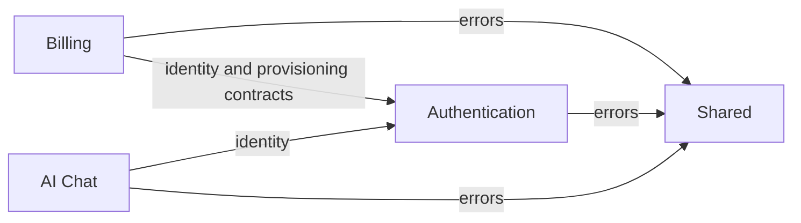

# Backend modular monolith

FinanceOps runs as one Spring Boot application, one deployable JAR, and one PostgreSQL database. Its business modules are organized by feature. Each module owns its HTTP adapters, application services, domain rules, and persistence implementation. Spring Modulith 2.1.1 declares and verifies their boundaries.

## Module ownership

| Module | Responsibility | Public in-process contracts | Database ownership |
| --- | --- | --- | --- |
| `auth` | Accounts, session authentication, signup orchestration | `auth :: identity` (`CurrentUser`, `UserProfile`); `auth :: provisioning` (`WorkspaceProvisioner` SPI) | `app_user` |
| `billing` | Workspaces, customers, invoices, payments, evidence, exact balances | `billing :: queries` (`BillingQueries`, immutable `BillingFacts`) | `tenant`, `customer`, `invoice`, `invoice_line`, `payment`, `payment_event` |
| `shared` | Error vocabulary, HTTP error mapping, health endpoint | `shared :: errors` | None |
| `chat` | Text conversations and direct OpenAI calls | None | None |



Modules are closed. `package-info.java` declares allowed dependencies and named interfaces. Public Java visibility inside a module does not make a class part of its public module API. Other modules cannot import its controllers, internal services, repositories, JPA entities, or security implementation.

Billing implements signup's provisioning SPI, so authentication depends on an interface it owns rather than importing billing internals. This keeps the module graph acyclic while preserving synchronous, atomic signup.

## Internal layers

```text
com.financeops
├── FinanceOpsApplication              application bootstrap
├── auth
│   ├── contract                      trusted current-user API
│   ├── spi                           signup extension contract
│   ├── api / api.dto                 HTTP adapters and response/request models
│   ├── application / application.port account use cases and storage port
│   ├── domain                        internal account data
│   ├── persistence / persistence.entity database adapters and JPA entities
│   ├── security                      Spring Security adapters
│   └── bootstrap                     demo account initializer
├── billing
│   ├── contract                      BillingQueries and immutable facts
│   ├── api / api.dto                 thin controllers and HTTP response mapping
│   ├── application / application.port query use cases and storage port
│   ├── domain                        snapshots and pure InvoiceCalculator
│   └── persistence                   JPA adapters, entities, repositories, seeds
└── shared
    ├── domain                        shared exceptions
    └── api                           exception handler and health endpoint
```

HTTP controllers translate requests and map facts into response DTOs. Billing controllers call `BillingQueries`. Application services orchestrate use cases through persistence ports and the trusted identity contract. Persistence adapters load tenant-scoped data and return detached snapshots. `InvoiceCalculator` performs exact financial arithmetic without Spring, JPA, or HTTP dependencies.

Application services may use Spring stereotypes, transactions, configuration injection, and the password-encoding abstraction. They do not depend on controllers, concrete database adapters, JPA, JDBC, or the security context. Domain rules and module contracts remain independent of these frameworks, apart from Modulith's package metadata annotations.

## Identity, transactions, and database

- `CurrentUser` reads the authenticated session and the stored account. Consumers cannot supply an email, tenant, or role to select identity.
- Every public billing query derives its tenant from `CurrentUser`. Only internal storage ports accept a tenant ID. Invoice lines are scoped through their parent invoice; customer, payment, and event lookups also enforce tenant scope.
- Missing and inaccessible records have the same generic 404 response. Financial HTTP endpoints remain read-only, and amounts remain backend-calculated with `BigDecimal`.
- Signup creates its workspace, starter and expanded records, and account inside one transaction. The billing provisioning adapter requires an existing transaction (`MANDATORY`); any failure rolls back the complete operation.
- Modules own their tables logically. They share a datasource and transaction manager; existing SQL foreign keys remain intact. Modules do not access each other's repositories or issue SQL against each other's tables.
- Existing Flyway V1–V4 migration locations, identities, and checksums remain compatible. The historical V4 database upgrade calls the billing fixture loader from the migration bootstrap package; it is not an application module integration API. This refactor does not reset, re-seed, or move the existing database.

## Enforced build boundaries

```sh
mvn -f backend/pom.xml clean package -DskipTests
```

The `verify-architecture` Maven execution runs after verification sources compile, including when `-DskipTests` is used. It calls Spring Modulith's `ApplicationModules.verify()` to reject module cycles, undeclared dependencies, and references to module internals. Additional ArchUnit rules reject layer violations such as controllers accessing persistence and application services importing JPA repositories.

`ArchitectureCheck` is a build-time static checker, not an application bean or a behavioral test suite. Modulith core and ArchUnit are build-only dependencies and are not packaged into the runtime JAR. No database is needed for the check. A Maven invocation that stops at `compile` does not run it; use the package command above.

The approach follows the official [Spring Modulith module and named-interface model](https://docs.spring.io/spring-modulith/reference/fundamentals.html) and [module verification rules](https://docs.spring.io/spring-modulith/reference/verification.html).

## AI chat

The closed `chat` module depends on `auth :: identity` and `shared :: errors`. Its single `POST /api/chat` controller calls `ChatService`, which verifies trusted identity, validates bounded user/assistant history, and calls the injected Spring AI `ChatClient`. Its configuration builds an `OpenAiChatModel` with the default model and generation options and registers a `CallAdvisor` for correlated request, response, and provider token usage logs. Automatic tool advisor registration is disabled. A lazy configuration bean permits normal billing startup without a configured API key. Provider failures map to generic recoverable 503 responses. Existing session authentication and CSRF handling protect the endpoint.

Chat registers no tools and reads no billing records. Its system instructions explain the practice billing rules and its lack of record access. Future record-grounded chat can consume `billing :: queries` through an explicitly declared module dependency, without importing repositories. Local startup remains `docker compose up --build -d`; configure `OPENAI_API_KEY` and optionally `OPENAI_MODEL` in the backend environment to enable responses.
